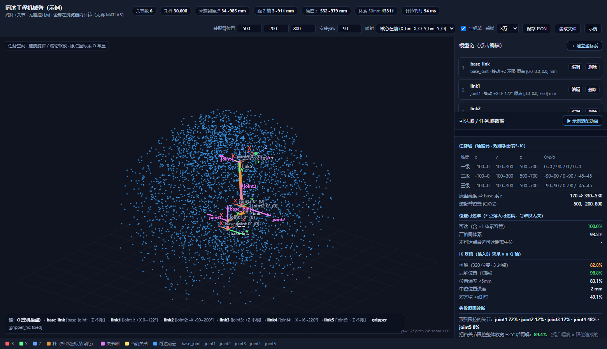

# Mathmatic-Robotic-Arm-Fast-Iterators

> 给一套「杆 + 关节 + 坐标系 + 角度限位」，秒级算出**带限位的可达集**，
> 并直接回答「这根杆改多长，比赛任务才更好做」。

浏览器里打开一个 HTML 文件就能用，不用装 MATLAB，不用联网。

---

## 这是什么

做 RoboMaster / 工程机器人臂型设计，最磨人的是「改一个杆长 → 等 CAD 出图 →
再算一遍够不够得着」这个循环。这个工具把它压到**几十毫秒**：

<p align="center">
  
</p>

**`build/armBuilder.html`** —— 建模器：建坐标系链、看可达集、校核比赛任务域、放装配动画。

> 连杆寻优（「哪几根杆改多长」）的**界面**已移除 —— 那部分改由另一个基于 URDF
> 的评判工具做，本工具专注"快速迭代臂型"。搜索/复核引擎
> （`web/src/modules/t11_link_mod.js`）仍保留，可用
> `node web/checks/t11_search.js` 无头调用。

具体能做的事：

- **建模**：在网页里按顺序搭坐标系链（相对上一坐标系的位置 / 三轴朝向 / 转动轴 / 限位），
  实时挡下不是右手系的填法。模型能存成 `.json` 分享或进版本管理。
- **可达集**：正解 + 随机采样 + 体素化，画出**带限位**的真实可达点云
  （带关节耦合的月牙形，不是教科书里那个理想球壳）。
- **任务校核**：内置比赛规则手册表 5-10 的三级位姿范围，
  直接给位置可达率、高度分层、带插入姿态约束的 IK 成功率。
- **尺寸合规**：底盘碰撞箱、1200×1200×1100 长宽高框、直径 1500 限制球，
  还有**地面上真正卡人的那个圈** √(750²−480²) = 576.3 mm。
- **连杆优化**：在杆长之和上限下搜索，最大化严格合格率
  （位置<3mm、姿态<3°、**且最紧关节裕度>5°**）。
- **装配动画**：核心本体固定不动，只有 Q 轴组件在动的五段式插入演示。

### 一个结论（详见 [`docs/notes/t11_连杆改进报告.md`](docs/notes/t11_连杆改进报告.md)）

| 改动 | 杆长和 | 严格合格率 | 分数 |
|---|---|---|---|
| 基准臂 | 1064 mm | 9% | 8.0 |
| `link2.y` 290→235 · `link3.x` 85.5→45 · `gripper.z` 211→150 | **908 mm** | **20%** | **17.7** |

代价是最大伸展 985→865 mm、可达体素 −20%，三级任务域位置可达率仍 100%。
另外两条反直觉的：**只缩工具段几乎没用，必须和横偏一起缩**；**小臂不能缩**。

---

## 怎么打开

**双击 `build/armBuilder.html` 就行。** 不需要装任何东西，不需要联网。

打开后会问 **新建 / 示例 / 上次**：

- **示例** —— 直接看同济示例臂（7 段链，规则与车体尺寸都配好了）
- **上次** —— 接着上次改的模型继续（存在浏览器本地）
- **新建** —— 走向导从零搭一条：**单臂 | 双臂 → base_yaw → 逐段搭 joint+link
  → 装配臂在世界系的位置 → 夹爪往哪个轴插入**

界面右侧是三块**可折叠**面板：**模型链** / **旋转角度**（实时关节角）/
**可达域·任务域数据**。顶栏的 **👁 显示** 下拉里是坐标架、底盘框、长宽高框、限制球四个开关。

建议用较新版本的 Chrome / Edge / Firefox。

想试连杆调参就双击 `build/armLink.html`（见下方「关于 build/」）。

**URL 快捷入口**（接在文件名后面）：

| 后缀 | 作用 |
|---|---|
| `#demo` | 直接进示例模型（不覆盖你的存档） |
| `#demosave` | 载入示例并存档 |
| `#anim` | 自动播放装配动画 |
| `#joints` | 直接展开关节滑条面板 |
| `#dump` | 把各坐标系数据铺满屏幕（核对数值用） |

例：`build/armBuilder.html#demo`

---

## 用什么写的

**纯手写。没有构建依赖，没有 npm 包，没有第三方库，没有 CDN。**

| 层 | 用的东西 |
|---|---|
| 交互工具 | 纯 **HTML + CSS + 原生 JavaScript**（ES6）。三维视图是 **Canvas 2D 手绘**，不是 three.js |
| 运动学 | 手写齐次变换递推 `T_i = T_{i-1}·Trans(offset_i)·Rot(axis_i,q_i)`，含 LM 阻尼最小二乘 IK |
| 模型格式 | **JSON**，网页里能直接「读取文件」载入 |
| 本地存档 | 浏览器 **localStorage**（界面参数刷新不丢） |
| 数值校验 | **MATLAB** + Robotics System Toolbox，外加一套不依赖工具箱的纯 MATLAB 正解 |
| 自检 | **Node.js** 脚本 + Edge 无头模式 |

---

## 关于 `build/` —— 交付物是单文件，但源码是分模块的

双击用的那份 HTML 里所有东西都内联在一起（所以才能零依赖、能离线、发一个文件就能给别人）。
但它**不是手改的**，是从 `web/src/` 合成出来的：

```bash
node web/build.js          # 在仓库根目录跑
```

改源码之后跑一次这个，`build/` 下就有了新的单文件 HTML。

`build/armBuilder.html` 已入库，clone 下来直接能双击；
`build/armLink.html` 是派生物，没入库，跑一次上面那条命令就有。

---

## 目录

```
build/         交付物：单文件 HTML，双击即用
web/           网页工具
  src/apps/      骨架模板
  src/modules/   引擎模块（运动学 / 任务规则 / 底盘尺寸 / 配置层）
  src/configs/   ★ 构型配置：臂型 + 比赛规则 + 车体尺寸
  checks/        无头自检
  lib/           合成器与路径表
  pack/          打包分享
matlab/        MATLAB 侧：数值实现与交叉验证
  setup.m        先跑这个加搜索路径
  model/         臂型定义 + 建树 + 正解 + 安装基准（armBase.m）
  core/          可行性集计算 / 界面 / 导出
  checks/        自检探针
docs/
  notes/         分析报告
  screenshots/   界面截图
  data/          示例臂模型 + 探针产物
HISTORY.md     开发日志与踩坑（含模块化重整与配置层改造的完整记录）
```

### 想换一条臂 / 换一套规则？

引擎不认「具体是哪条臂」——它只认配置。加一个构型不用改引擎：

```
web/src/configs/
  index.txt      清单，一行一个（第一个是默认）
  tongji.js      同济示例：臂型 + 规则手册表5-10 + 车体尺寸
  demo3dof.js    最小测试臂：3 自由度、无规则、无车体（证明"没有规则也能跑"）
  dual_demo.js   双臂示例：左 4 轴 + 右 3 轴，各自基座与安装朝向
```

> 「新建」向导产出的构型会作为一个 `*_wiz` 配置挂上，**不带规则与车体尺寸**
> （那些属于具体比赛，不该从别的构型继承过来）。要给新构型加规则，
> 在 `web/src/configs/` 里补一份 `rules` 即可。

复制一份改数值、在 `index.txt` 里加一行，顶栏的「配置」下拉框里就会出现它。

**多臂**用 `arms` 数组写（单臂仍用 `model`，两者都收）：

```js
defineConfig('my_dual', {
  arms: [
    { name:'左臂', base:{xyz:[60,180,250], yaw:-90}, links:[...] },
    { name:'右臂', base:{xyz:[-60,180,250], yaw: 90}, links:[...] }
  ],
  rules: null, chassis: null
});
```

两条臂的**关节数、限位、基座、安装朝向都可以不同**。关节角是同一个扁平向量
（左臂占 `[0, n₁)`、右臂紧接着），所以「协同」天然成立——同一组 q 下两条臂同时到某处。
各臂的可达集分别统计，也能一起看。

> 臂间**碰撞/干涉不在本工具范围内**（见下方已知边界）。

`web/checks/t12_arm_swap.js` 用 3 / 7 自由度的臂跑全链路，
`t13_multi_arm.js` 专门压多臂（含"改一条臂的基座、另一条不受影响"这类断言），
确保引擎没有偷偷依赖某一条具体的臂。

---

## 用 MATLAB（可选）

需要 **MATLAB + Robotics System Toolbox**。这个工具链是给「数值交叉验证 / 批量计算」用的，
只想用工具的话完全不用管它。

```matlab
run('<本仓库>/matlab/setup.m')    % 加搜索路径

app = armFeasApp;                 % 打开界面
f   = app.export();               % 导出到 build/armFeas.html
P   = armFeasData(cfg);           % 只要数据、不要界面
```

改臂型**只改 `matlab/model/armSpec.m` 一个文件**：往 `spec` 里加一项，
界面自动多一行控件，网页自动多画一段杆和一条关节轴。

---

## 已知边界

1. **没有碰撞、没有动力学、没有重力** —— 只回答「运动学上能不能到」。
   底盘碰撞箱只是显示，不参与判据；机械臂本身没有碰撞体，
   所以工具**不给**整机长宽高包围盒（拿骨架量出来是假数）。
   **多臂时两条臂之间也不做干涉检查** —— 各自算各自的，只保证"同一时刻的关节角"。
2. **关节限位只支持区间**。月牙形的耦合区域要靠 `crescentMargin` / `crescentBounds` 表达；
   RST 原生的 `generateRobotWorkspace` 算月牙会得到**过近似**。
3. **纯限位 ≠ 一定不碰**：实测工具尖能到 z ≈ −9 mm（擦地）。
   统计最大伸展时会剔除地面以下的采样点。
4. **样本占比 ≠ 体积占比**：任务空间点云由关节空间均匀采样得到，要精确体积请看体素数。
5. **连杆改不出「绕 Q 轴自转」**：6 个关节里没有「绕插入轴」那一级，
   绕插入轴能连续转过的弧中位只有 30°。这是轴系拓扑决定的，改杆长解决不了，得补腕部 roll。
6. **`matlab/checks/t7_ik_matlab.m` 一度完全不可信，现在修好了**（2026-10）。
   它曾报「RST 可解 0/200」，实际是**两个 bug 叠在一起**：MATLAB 与网页的基准系
   不统一（差 90°），以及目标点把 **mm 当 m** 喂给了 `inverseKinematics`。
   修完之后：**199/200 = 99.5%，位置误差中位 0.00 mm**，与
   `t9_ik_truth.py` 的独立求解器（320/320）互相印证。
   完整复盘见 [`docs/notes/t7_基准系与单位问题.md`](docs/notes/t7_基准系与单位问题.md)。

---

## 历史

`README.md` 原本是 650 行的开发日志，2026-10 拆开了：
面向使用者的说明留在这份 README，开发过程、bug 复盘、实测数据、
以及 2026-10 的模块化重整记录，都在 **[`HISTORY.md`](HISTORY.md)**。
